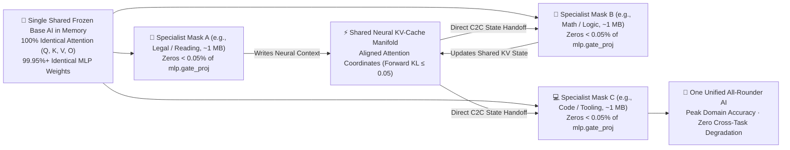

# 🧩 On *"The Surprising Effectiveness of Deleting Weights in LLM Post-Training"* — Could Task-Specific Deletion Masks Be Connected via Cache-to-Cache (`C2C`) into One Unified AI?

<p align="center">
  <strong>CKU Theory (Cache-to-Cache Mask Unification): Connecting Pure Domain-Specific Deletion Masks on a Single Shared Backbone via Direct Neural KV-Cache Sharing</strong><br>
  <em>A Theoretical Hypothesis & Architectural Extension Note by <a href="https://axnli.com">AXNli Inc.</a> (Systems for Data & AI)</em>
</p>

<p align="center">
  <a href="./README.md"></a>
  <a href="./README.ko.md"></a>
  <a href="https://arxiv.org/abs/2611.10866"></a>
  <a href="https://axnli.com"></a>
  <a href="./LICENSE"></a>
</p>

---

> 🇰🇷 **한국어 원문 이론 노트는 [README.ko.md](./README.ko.md)에서 확인하실 수 있습니다.**

---

## 1. Respectful Attribution & Motivation

> [!NOTE]
> **Credit & Deep Appreciation to Foundational Work**  
> This theoretical architectural note is directly inspired by the remarkable NeurIPS 2026 paper ***"The Surprising Effectiveness of Deleting Weights in LLM Post-Training"*** (`arXiv:2611.10866`) by **Jack Lu, Zhenbang Yang, Mike Lasby, Tejas Pote, Yani Ioannou, and Mengye Ren** (*New York University & University of Calgary*) and their clean, open-source MIT-licensed implementation ([`agentic-learning-ai-lab/deleting-weights`](https://github.com/agentic-learning-ai-lab/deleting-weights)), alongside the **Cache-to-Cache (`C2C`)** direct neural KV-communication paradigm introduced by Fu et al. (*Tsinghua University*, `arXiv:2510.03215`). We express our sincere admiration to both research teams for opening new frontiers in post-training geometry and neural state communication.

In ***"The Surprising Effectiveness of Deleting Weights in LLM Post-Training"***, Lu et al. (2026) revealed a profound property of pretrained language models: **zeroing fewer than `0.05%` of weights (specifically inside `mlp.gate_proj`), without writing a single new floating-point value, matches Full Fine-Tuning (`FFT`) across RLVR (`GRPO`), `SFT`, and On-Policy Self-Distillation (`SDFT`)**.

Two empirical properties reported by Lu et al. stood out to us immediately:
1. **Ultra-Compact Task Mastery**: Each domain specialist is no longer a multi-gigabyte model checkpoint, nor even a tens-of-megabytes `LoRA` adapter—it is a `packbits + zstd` compressed binary bitmap (`~1 MB` at `< 0.05%` sparsity).
2. **Distribution & Subspace Preservation**: Because `99.95%+` of all weights remain untouched and every attention layer is completely frozen, the forward KL divergence from the base model remains remarkably small ($\mathrm{KL} \le 0.05$).

---

## 2. The Open Question: What Happens Beyond a Single Specialty?

When reading the per-subject `SFT` experiments (such as the 14 distinct categories of `MMLU-Pro` and 23 tasks of `BBEH`, where each specialty trains its own optimal deletion mask) and **Section 6 (*Limitations and Future Work*)**, a natural question arises:

> **Suppose we train a Deletion Mask to maximize Mathematical Reasoning, and it boosts math accuracy significantly. What happens to non-math domains—or what happens when we want *one* AI system that excels at Math, Law, Coding, Science, and Humanities simultaneously?**

If we attempt to merge multiple domain masks into a **single static weight matrix** (for instance, by taking a naive static mask union across many distinct domains), a subtle trade-off can emerge: a `gate_proj` circuit suppressed to sharpen mathematical deduction might carry useful nuance for legal interpretation or creative synthesis. As more specialties are statically intersected onto the same matrix, cumulative deletions risk eroding non-target skills.

This led us to ask a constructive **"What if...?"** question:

> **Instead of collapsing different domain masks into one static mask, what if we keep every individual Deletion Mask 100% pure at its peak specialty, and connect them dynamically at the neural network level via `Cache-to-Cache (C2C)` state sharing—forming *One Unified AI*?**

---

## 3. Core Hypothesis: `CKU` (Cache-to-Cache Mask Unification)

### 3.1 Why Traditional Multi-Model `C2C` Was Hard—and Why `Deletion Tuning` Changes Everything

Normally, connecting multiple specialized LLMs via **Cache-to-Cache (`C2C`)**—transferring internal `KV-Cache` tensors directly between specialists rather than re-generating and re-reading verbose text—faces two steep engineering barriers:
1. **VRAM / RAM Multiplication**: Hosting $N$ full fine-tuned specialist models requires $N \times$ the base model's memory footprint.
2. **Attention Coordinate Drift**: Independently fine-tuned models shift their query/key/value (`Q, K, V`) subspaces, requiring trained neural projection modules to translate one model's `KV-Cache` into another's coordinate space.

**`Deletion Tuning` naturally dissolves both barriers at the root—because every specialist is born from the *exact same frozen AI neural network*.**



### 3.2 Mathematical Foundation of Same-Backbone `C2C` Alignment

In the official architecture of [`agentic-learning-ai-lab/deleting-weights`](https://github.com/agentic-learning-ai-lab/deleting-weights) (`TARGET_MODULES = ["gate_proj"]`), let $\theta_0$ denote the frozen pretrained backbone and let $M^{(k)} \in \{0, 1\}^{d_{\text{ff}} \times d_{\text{model}}}$ denote the binary deletion mask for specialty $k \in \{1, \dots, K\}$.

1. **Bit-for-Bit Identical Attention Operators Across All Specialists**:
   At every transformer layer $l \in \{1, \dots, L\}$, the attention projection matrices of Specialist $A$ and Specialist $B$ are **strictly identical**:

$$
W_Q^{(l, A)} \equiv W_Q^{(l, B)} \equiv W_Q^{(l, 0)}, \qquad
W_K^{(l, A)} \equiv W_K^{(l, B)} \equiv W_K^{(l, 0)}, \qquad
W_V^{(l, A)} \equiv W_V^{(l, B)} \equiv W_V^{(l, 0)}
$$

2. **Bounded Policy & Hidden-State Perturbation**:
   Only the SwiGLU gate projection inside the MLP block changes via ultra-sparse elementwise masking ($\lVert \mathbf{1} - M^{(l, k)} \rVert_0 / \lvert M^{(l, k)} \rvert < 5 \times 10^{-4}$):

$$
\mathrm{MLP}^{(l, k)}(x) = W_{\text{down}}^{(l, 0)} \Big( \mathrm{SiLU}\!\big((W_{\text{gate}}^{(l, 0)} \odot M^{(l, k)})\, x\big) \odot (W_{\text{up}}^{(l, 0)} x) \Big)
$$

   Because Lu et al. show that $\mathrm{KL}(\pi_{\theta_0} \parallel \pi_{\theta_k}) \le 0.05$ and that singular-value spectrum drift remains minimal, the residual stream states $h^{(l)}$ remain anchored to the pretrained manifold of $\theta_0$.

3. **Zero-Reload, Single-Backbone `C2C` Continuity**:
   When Specialist Mask $A$ processes context tokens $x_{1:t}$ and populates the layer-wise cache $\mathcal{C}_{1:t} = \{(K_{1:t}^{(l)}, V_{1:t}^{(l)})\}_{l=1}^{L}$, Specialist Mask $B$ can **immediately attend over $\mathcal{C}_{1:t}$ in-place** for step $t+1 \dots T$ simply by switching the active sparse `gate_proj` mask pointer from $M^{(A)}$ to $M^{(B)}$:
   * **Zero duplicate model weights** in VRAM/RAM ($1\times$ base backbone + $K \times \sim 1\text{ MB}$ compressed masks).
   * **Zero cross-domain destructive interference**, because Mask $A$ never deletes circuits needed during Mask $B$'s reasoning phase.
   * **Direct neural continuity (`C2C`)**, avoiding lossy text re-serialization while preserving each specialist's full FFT-level accuracy.

---

## 4. Architectural Comparison

| Dimension | Static Mask Union (Single Merged Mask) | Multi-Model Heterogeneous `C2C` | **🧩 `CKU` Theory: Deletion Masks + Same-Backbone `C2C`** |
| :--- | :--- | :--- | :--- |
| **Per-Domain Peak Accuracy** | Vulnerable to cross-domain mask collisions | High (separate models) | **Preserved at 100% per-mask peak** |
| **Non-Target Domain Degradation** | Accumulates as more masks are unioned | None | **Eliminated (masks activate selectively per phase)** |
| **Memory Footprint ($K$ Specialists)** | $1\times$ Backbone | $K \times$ Backbone (prohibitive for large $K$) | **$1\times$ Backbone + $K \times \sim 1\text{ MB}$ Bitmaps** |
| **Attention (`Q, K, V`) Alignment** | Identical | Mismatched (requires trained KV projectors) | **100% Bit-Identical (`Forward KL ≤ 0.05`)** |
| **Specialist Switching Cost** | N/A (static) | Multi-GB weight swap or multi-GPU hosting | **Microseconds (sparse `gate_proj` index toggle)** |

---

## 5. Conceptual PyTorch Reference Blueprint

Below is a concise conceptual blueprint illustrating how multiple `Deletion Tuning` specialist masks share **one frozen model in memory** and hand off thoughts directly through a **shared `KV-Cache` (`C2C`)**:

```python
import torch
import torch.nn as nn
from typing import Dict, List, Tuple


class SharedBackboneC2CUnifiedModel:
    """
    Conceptual blueprint for CKU (Cache-to-Cache Mask Unification):
    One frozen pretrained LLM backbone + N ultra-sparse gate_proj Deletion Masks
    communicating directly over a shared neural KV-Cache (C2C).
    """

    def __init__(self, frozen_base_model: nn.Module) -> None:
        self.model = frozen_base_model.eval()
        for p in self.model.parameters():
            p.requires_grad_(False)

        # Store only the sparse (row, col) indices to zero out (<0.05% of gate_proj)
        self.specialist_zero_indices: Dict[str, Dict[str, torch.Tensor]] = {}
        self._active_backup: List[Tuple[torch.Tensor, torch.Tensor, torch.Tensor]] = []

    def register_deletion_mask(
        self, domain_name: str, keep_masks: Dict[str, torch.Tensor]
    ) -> None:
        """Register a task-specific boolean keep-mask (False = deleted position)."""
        sparse_zeros: Dict[str, torch.Tensor] = {}
        for param_name, keep_bool in keep_masks.items():
            zero_flat_idx = (~keep_bool.reshape(-1)).nonzero(as_tuple=False).squeeze(-1)
            sparse_zeros[param_name] = zero_flat_idx
        self.specialist_zero_indices[domain_name] = sparse_zeros

    @torch.no_grad()
    def activate_specialist(self, domain_name: str) -> None:
        """Restore previous ~0.04% zeroed entries and apply the new specialist's mask in microseconds."""
        self.restore_base()
        params = dict(self.model.named_parameters())
        for param_name, zero_idx in self.specialist_zero_indices[domain_name].items():
            w_flat = params[param_name].view(-1)
            idx_dev = zero_idx.to(w_flat.device)
            saved_vals = w_flat.index_select(0, idx_dev).clone()
            self._active_backup.append((w_flat, idx_dev, saved_vals))
            w_flat.index_fill_(0, idx_dev, 0.0)

    @torch.no_grad()
    def restore_base(self) -> None:
        """Restore exact pretrained weights cleanly."""
        for w_flat, idx_dev, saved_vals in self._active_backup:
            w_flat.index_copy_(0, idx_dev, saved_vals)
        self._active_backup.clear()

    @torch.no_grad()
    def forward_c2c_phase(
        self,
        domain_name: str,
        input_ids: torch.Tensor,
        past_key_values=None,
    ):
        """
        Run a reasoning phase under `domain_name` specialist mask while directly
        inheriting and extending the shared neural `past_key_values` (C2C handoff).
        """
        self.activate_specialist(domain_name)
        outputs = self.model(
            input_ids=input_ids,
            past_key_values=past_key_values,
            use_cache=True,
        )
        return outputs.logits, outputs.past_key_values
```

---

## 6. Open Research Questions for Empirical Exploration

To keep this proposal scientifically rigorous, we highlight three concrete questions worth testing empirically:
1. **Zero-Shot vs. Lightweight Calibration in Mid-Sequence `C2C` Handoff**: Given $\mathrm{KL}(\pi_{\theta_0} \parallel \pi_{\theta_k}) \le 0.05$ and identical `Q, K, V` projections, does mid-sequence mask switching preserve `100%` of downstream accuracy zero-shot, or does a tiny per-layer scalar temperature rescale further smooth transitions on `SDFT` masks with higher sparsity?
2. **Backbone Capacity Threshold**: Since ultra-small models (`~0.5B`) possess less pre-existing circuit redundancy than `3B–30B` backbones, what is the optimal minimum shared backbone scale where `Deletion Tuning + C2C` outperforms multi-`LoRA` ensembles?
3. **Phase Routing Over Shared `KV-Cache`**: Coupling a fast, calibrated single-pass decision gate to select which `~1 MB` domain mask governs each reasoning segment over the shared `KV-Cache`.

---

## 7. Position Within the `AXNli CK` Architecture Series

At **[AXNli Inc.](https://axnli.com)**, **`CKU` (Cache-to-Cache Mask Unification)** extends our open architectural research series on modular, reliable intelligence:
* **[`CKN` (`CKN-Architecture`)](https://github.com/kokogo100/CKN-Architecture)** — *Pre-Generation*: Hippocampus-inspired fractal memory and contradiction-triggered (`A ≠ B`) active inquiry.
* **[`CKS` (`CKS-Architecture`)](https://github.com/kokogo100/CKS-Architecture)** — *Intra-Generation*: Dead-zone closed-loop token-time PID activation steering.
* **[`CKU` (`CKU-Architecture`, *This Note*)](https://github.com/kokogo100/CKU-Architecture)** — *Multi-Domain Neural Unification*: Connecting pure `Deletion Tuning` domain masks on a single frozen backbone via `Cache-to-Cache (C2C)` state sharing.
* **[`CKD` (`CKD-Architecture`)](https://github.com/kokogo100/CKD-Architecture)** — *Post-Generation*: Air-gapped triadic verification and closed-loop knowledge distillation.

---

## 8. References, Citation & Search Tags

### Foundational References
1. **Deletion Tuning (NeurIPS 2026)**: Jack Lu, Zhenbang Yang, Mike Lasby, Tejas Pote, Yani Ioannou, and Mengye Ren (2026). *"The Surprising Effectiveness of Deleting Weights in LLM Post-Training."* `arXiv:2611.10866`. Official Code (MIT): [https://github.com/agentic-learning-ai-lab/deleting-weights](https://github.com/agentic-learning-ai-lab/deleting-weights)
2. **Cache-to-Cache (`C2C`)**: Tianyu Fu et al. (2025). *"Cache-to-Cache: Direct Semantic Communication Between Large Language Models."* Tsinghua University, `arXiv:2510.03215`.

### Citing This Architectural Note
```bibtex
@misc{axnli2026cku,
  title  = {CKU (Cache-to-Cache Mask Unification): Connecting Task-Specific Deletion Masks on a Shared Backbone into One Unified AI},
  author = {AXNli Inc.},
  year   = {2026},
  note   = {Theoretical Architectural Extension Note inspired by Lu et al. (NeurIPS 2026, arXiv:2611.10866)},
  url    = {https://github.com/kokogo100/CKU-Architecture}
}
```

### Search Tags & Topics
`#DeletionTuning` `#DeletingWeights` `#LLMPostTraining` `#NeurIPS2026` `#arXiv261110866` `#CacheToCache` `#C2C` `#KVCache` `#KVCacheSharing` `#UnifiedAI` `#ModularLLM` `#ContinualLearning` `#CatastrophicForgetting` `#SparseMasks` `#SubnetworkSelection` `#LotteryTicketHypothesis` `#PEFT` `#ParameterEfficientFineTuning` `#GateProj` `#SwiGLU` `#PackbitsZstd` `#ZeroForgetting` `#MultiDomainAI` `#SharedBackbone` `#NeuralCommunication` `#SLM` `#SmallLanguageModels` `#AIArchitecture` `#AXNli` `#CKU`

* **Originated by**: **[AXNli Inc. (`주식회사 에이엑스엔엘아이`)](https://axnli.com)**
* **License**: MIT License (© 2026 AXNli Inc.)
